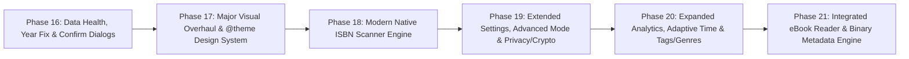

# BookStack Product & Architecture Roadmap (Phases 16–21)

> **Single Source of Truth for Upcoming Milestones:** This document captures the strategic product vision, architectural boundaries, and functional requirements for **Phases 16 through 21**. For the active sprint index and completed phase archive, see [`docs/TASKS.md`](TASKS.md).
>
> **Pre-Phase Protocol:** Before breaking down any phase below into atomic `docs/tasks/phase-XX-<name>/task-X.Y-*.md` specifications, run a focused `/grill-me` alignment pass with the user to incorporate any new details or visual adjustments for that specific phase.

---

## 1. Strategic Sequencing & Architectural Rationale

1. **Why Foundation & Data Hygiene First (`Phase 16`):** Fixes the anomalous year filter defect (`2925`) in `/stats`, enforces temporal sanity bounds across schemas/forms/importers, replaces all native browser `window.confirm()` alerts with an accessible in-app confirmation modal (`ConfirmDialogService` + `<app-confirm-dialog>`), and introduces a Library Data Health Auditor before visual or schema expansions.
2. **Why the Design System Overhaul Second (`Phase 17`):** Centralizing semantic design tokens (`@theme` in Tailwind CSS v4) and executing the site-wide visual modernization _before_ building multi-tab Extended Settings (`Phase 19`), new Analytics visualizations (`Phase 20`), or the eBook Reader (`Phase 21`) ensures all upcoming views are built directly on the new visual language rather than styled twice.
3. **Why Modernizing the Native ISBN Scanner Third (`Phase 18`):** Replaces the unmaintained `html5-qrcode` wrapper with a fast, 100% Local-First native `getUserMedia()` + `BarcodeDetector` / local ZXing-C++ WASM engine, resolving Android multi-lens Camera2 startup delays, cutting bundle weight, and adding flashlight (torch) control before expanding settings and analytics.
4. **Why Extended Settings & Privacy Fourth (`Phase 19`):** Consolidates user-configurable preferences (including theme/accent tokens from Phase 17, confirmation dialog toggles from Phase 16, strict 100% Offline Mode, metadata provider toggles, `navigator.storage.persist()`, and `AES-GCM` encrypted backups) into a structured, categorized `/settings` hub with an **Advanced Mode**.
5. **Why Expanded Analytics & Adaptive Time Fifth (`Phase 20`):** Leverages the new design tokens and user preferences to make time/velocity metrics adaptive (hiding `pp/h` and time tabs when no timed sessions exist), introduces book genres/tags (`tags`), annual activity heatmaps, longevity/pacing metrics, and period-over-period comparisons.
6. **Why the Integrated eBook Reader Sixth (`Phase 21`):** Serves as the flagship long-term evolution. By storing `.epub`/`.pdf` binaries in a dedicated IndexedDB `ObjectStore` (`ebookFiles`), extracting embedded metadata/covers natively in the browser, and auto-logging timed reading sessions from `/reader/:id`, it organically feeds the adaptive time/velocity analytics created in Phase 20 without manual stopwatch friction.

---

## 2. Detailed Phase Specifications

### Phase 16: Data Health, Temporal Bounds Fix (`2925`) & Native Confirmation Dialog Engine

- **Status:** Completed ([`docs/tasks/phase-16-data-health-and-confirm-dialogs/index.md`](tasks/phase-16-data-health-and-confirm-dialogs/index.md))
- **Primary Goal:** Eliminate native browser confirmation dialogs in favor of a cohesive, accessible in-app confirmation system, resolve anomalous date/year filtering bugs (`2925`) across analytics and forms while honoring antique book publication years, and provide a 1-click Data Health Auditor.
- **Core Deliverables:**
  1. **Temporal Sanity Bounds, Antique Book Tolerance & `/stats` Year Filter Fix (`2925` Defect):**
     - Enforce logical personal reading date bounds (`1900-01-01` through `currentYear + 1`) across `BookSchema`, `ReadingLogSchema`, `<input type="date">` controls (`min`/`max`), and `DataPortabilityService` import normalizers, while strictly rejecting impossible future years (`> currentYear + 1` such as `2925`).
     - **Source-Aware Antique Book Publication Years (`publicationYear`):** Allow classic/antique books that are hundreds of years old (`< 1900`). When `publicationYear` comes from an external metadata provider/database (`Open Library`, `Google Books`, `Wikidata`, `Apple Books`, `Internet Archive / Crossref`) or backup import, accept historical years silently; when entered **manually** by the user (`< 1900`), show a confirmation warning asking the user to verify that the antique year is intentional and not a typo.
     - Harden `AnalyticsService.availableYears()` and the `all-time` multi-year trend bucket generator so out-of-range typo years (e.g., `2925` instead of `2025`) cannot pollute the year selector or spawn hundreds of empty chart buckets.
  2. **In-App Confirmation Dialog Engine (`ConfirmDialogService` & `<app-confirm-dialog>`):**
     - Replace all native `window.confirm()` calls with a Promise-based, Signal-driven modal component styled with BookStack's modal animations, keyboard focus trap, Escape closure, and `UiStateService` reference-counted scroll lock.
     - Support contextual entity summaries (e.g., cover thumbnail + book title/author when deleting a book, session details when deleting a reading log, saga summary when unlinking/deleting), severity variants (`danger`, `warning`, `info`), and an optional **"Do not ask again for minor actions"** checkbox persisted in preferences.
     - Apply across all sensitive operations:
       - Deleting a book (`/books` cards, rows, and detail modals).
       - Deleting a reading session log (`books-page` and `book-detail-modal`).
       - Unlinking a book from a saga or deleting saga metadata in `/series`.
       - Overwriting the library during backup restoration (`Overwrite` mode) or executing bulk data health fixes in `/settings`.
  3. **Library Data Health Auditor:**
     - Detect anomalous records locally (impossible future/past dates like `2925`, completed books with `0` total pages, probable duplicate ISBN/title entries, or near-duplicate saga names) and surface guided 1-click remediation actions.

---

### Phase 17: Major Visual Overhaul & Tailwind CSS v4 `@theme` Design System Modernization

- **Status:** Completed ([`docs/tasks/phase-17-visual-overhaul-and-dock-shell/index.md`](tasks/phase-17-visual-overhaul-and-dock-shell/index.md), plus follow-ups 17B–17D)
- **Primary Goal:** Elevate BookStack's entire UI to a modern, editorial-grade aesthetic while preserving its fast Local-First ergonomics, asymmetric responsive shell, and `320px` mobile parity.
- **Core Deliverables:**
  1. **Semantic Tailwind CSS v4 `@theme` Token Architecture (`src/styles.css`):**
     - Centralize surface hierarchy (`--surface-canvas`, `--surface-card`, `--surface-elevated`, `--surface-glass`), subtle border tokens, elevation shadows, radii, and semantic typography scales.
     - Introduce a richer, warmer high-contrast dark mode alongside a crisp editorial light mode.
  2. **Customizable Brand Accent Palettes:**
     - Support user-selectable accent themes (e.g., Classic Blue, Indigo, Emerald, Editorial Amber, Rose/Violet) powered by CSS custom properties with zero runtime bundle overhead.
  3. **Modernized Floating / Dock Navigation Shell:**
     - Redesign the desktop collapsible `SidebarComponent`, mobile `HeaderComponent`, and mobile `BottomNavComponent` with refined glassmorphism, subtle borders, pill/dock indicators, and fluid discrete transitions.
  4. **Editorial Typography & Bento Surface Refresh:**
     - Apply tabular numerals (`tabular-nums`) across all KPIs, page counters, and progress badges; refine spacing, hierarchy, and container breathing room across Dashboard (`/`), Catalog (`/books`), Sagas (`/series`), Analytics (`/stats`), Settings (`/settings`), and About (`/about`).
  5. **Premium Book & Saga Card Craftsmanship:**
     - Realistic cover depth and shadow framing, subtle hover/focus elevation, integrated progress bars, and tactile micro-interactions across all 3 catalog view modes and saga Bento cards.

---

### Phase 18: Modern Native ISBN Scanner Engine (`getUserMedia` + `BarcodeDetector` & Local ZXing-WASM)

- **Status:** Completed (`v2.4.0`, [`docs/tasks/phase-18-native-isbn-scanner-engine/index.md`](tasks/phase-18-native-isbn-scanner-engine/index.md))
- **Primary Goal:** Replace the unmaintained, heavyweight `html5-qrcode` wrapper with a fast, 100% Local-First, offline-capable native camera and barcode scanning engine that opens primary rear lenses in `<500 ms` across multi-camera Android, iOS Safari, Firefox, and desktop browsers.
- **Core Deliverables:**
  1. **Hybrid Native `BarcodeDetector` + Local ZXing-C++ WASM Ponyfill (`BarcodeDecoderService`):**
     - Use hardware-accelerated browser-native `window.BarcodeDetector` (`ean_13`, `ean_8`) on Chrome/Brave/Edge with zero extra JS overhead, and lazy-load `barcode-detector/ponyfill` backed by a locally bundled `assets/wasm/zxing_reader.wasm` (zero CDN dependencies, CSP `'wasm-unsafe-eval'`, offline Service Worker cache) on Safari/Firefox.
  2. **Native Camera Controller & Device Memory (`CameraStreamService`):**
     - Own `navigator.mediaDevices.getUserMedia()`, passive `enumerateDevices()`, Camera2 primary-sensor index ranking (`camera 0` / `camera 1`), `localStorage` preferred rear `deviceId` memory for instant repeat startup, short dead-sensor timeouts, progressive continuous autofocus/HD enhancement, and guaranteed `MediaStreamTrack.stop()` cleanup.
  3. **Modernized `<app-isbn-scanner>` Viewfinder & Flashlight (Torch) Control:**
     - Native `<video playsinline muted autoplay>` with a sleek Tailwind v4 viewfinder overlay, throttled live scan loop, conditional `>= 44×44px` flashlight/torch toggle button, 1-tap front/rear flip or cleaned desktop `<select>`, and unified static photo upload decoding—removing `html5-qrcode` completely.

---

### Phase 19: Extended Categorized Settings (`/settings`), Privacy/Offline Controls & Web Crypto Backups

- **Status:** Completed (`v2.5.0`, [`docs/tasks/phase-19-extended-settings-privacy-crypto/index.md`](tasks/phase-19-extended-settings-privacy-crypto/index.md))
- **Primary Goal:** Transform `/settings` into a comprehensive, well-organized **Master-Detail Control Center** separated into 5 thematic categories with URL `?tab=` sync and instant search, while hardening local data persistence, network privacy, scanner defaults, and backup security.
- **Core Deliverables:**
  1. **Master-Detail Categorized Settings Architecture & Live Search:**
     - Organize `/settings` into 5 navigable categories (sticky vertical sidebar on desktop + horizontally scrollable pill tabs on mobile): **General & Appearance**, **Catalog & Reading**, **Data & Backups**, **Privacy & Scanner**, and **Advanced & System** (always visible with `"Expert"` badge), backed by `?tab=` URL sync, bilingual instant settings search with jump-and-highlight, and a passive 30-day backup reminder banner.
  2. **Unified `AppPreferencesService`, Appearance & Catalog/Reading Defaults:**
     - Add Adaptive Cover Tinting (`--book-tint`) toggle and manual Reduced Motion override; move & expand Catalog/Reading controls (default view & sort, new book default format/status, card quick-actions & progress bar visibility, Dashboard quick-page increment step, reading time tracking toggle, and granular per-action confirmation dialog switches).
  3. **Strict Network Privacy, 5-Provider Controls & Scanner Privacy:**
     - Master **"100% Offline Mode"** toggle blocking all outbound requests to external metadata/cover providers.
     - Granular provider controls allowing the user to enable, disable, or reorder the 5 public metadata sources (Google Books, Open Library, Apple Books ES, Wikidata, Internet Archive / Crossref), plus camera consent management, remembered rear camera `deviceId` reset, and scanner defaults (Photo Mode / Auto-Torch).
  4. **Storage Resilience, Preferences Sync & Password-Encrypted Backups (`AES-GCM-256`):**
     - 1-click **Persistent Storage Request** (`navigator.storage.persist()`) with live browser eviction-protection status and IndexedDB health diagnostics.
     - Optional inclusion/restoration of app preferences in full `.JSON` and `.ZIP` backups.
     - Zero-dependency password-encrypted `.JSON` and `.ZIP` backups using browser-native Web Crypto API (`PBKDF2` + `AES-GCM-256`) with transparent password-prompted import.
  5. **Advanced System Controls, Selective Resets & Diagnostics:**
     - Configurable cover compression parameters (max pixel dimension and WebP/JPEG quality factor), metadata search quota tuning (`4`/`8`/`12`), selective partial resets (clear cover color cache, clear reading logs only, or reset preferences without losing books), strictly anonymous technical diagnostic JSON export, and relocated Danger Zone (`#danger-zone`) with a quick-jump link from Data & Backups.

---

### Phase 20: Expanded Analytics (`/stats`), Adaptive Time/Velocity Engine & Tags/Genres Taxonomy

- **Status:** Roadmapped
- **Pre-Phase Note:** _Review with the user at phase start to incorporate any additional custom charts or reading habit metrics._
- **Primary Goal:** Make time and reading-speed analytics smartly adaptive for users who do not log timed sessions, introduce a flexible Genres/Tags taxonomy, and expand `/stats` with deeper reading habit insights.
- **Core Deliverables:**
  1. **Adaptive Time & Reading Speed (`pp/h`) Disclosure:**
     - When the active period contains zero timed reading sessions (`totalTimeMinutes === 0`)—or when the user disables time tracking in `/settings`—automatically hide reading speed (`pp/h`) and the "Time" velocity chart tab.
     - Dynamically promote high-value non-timed KPIs into the 4-card executive grid (such as **Average Book Rating**, **Average Pages per Completed Book**, or **Active Reading Days**).
     - Seamlessly reveal time and velocity metrics whenever timed sessions are logged (or automatically recorded by the Phase 21 eBook Reader).
  2. **Genres & Custom Tags Taxonomy (`Book.tags` / `genres`):**
     - Extend `Book` and `BookSchema` with normalized genres/tags, autocomplete tag chips in Create/Edit modals, catalog filtering by tag, and automatic genre enrichment from the 5 metadata providers.
     - Add a **Genre / Thematic Distribution** visualization and dual Top Authors ranking (by completed books and by total pages read) in `/stats`.
  3. **Annual Reading Activity Calendar Heatmap:**
     - GitHub-style 365-day SVG/CSS activity heatmap visualizing daily reading intensity and consistency across the selected year.
  4. **Book Longevity, Length Distribution & Saga Progress Analytics:**
     - Average days to finish a book (from `startDate` to `endDate`), book length buckets (Short $< 250\text{p}$, Medium $250\text{–}500\text{p}$, Long $> 500\text{p}$), and saga completion analytics.
  5. **Period-over-Period Comparisons & All-Time Personal Records:**
     - Relative delta indicators (`+%` / `-%` vs. previous year/period) and personal milestone cards (longest book read, highest-volume month, all-time longest streak, oldest/newest publication year read).

---

### Phase 21 (Long-Term Milestone): Integrated eBook Reader (`/reader/:id`) & Binary Metadata Extractor

- **Status:** Long-Term Roadmap Milestone
- **Primary Goal:** Allow users to upload, inspect, and read `.EPUB` (and optional `.PDF`) files directly inside BookStack with 100% client-side metadata extraction, isolated binary storage, and automatic reading progress & session time synchronization.
- **Core Deliverables:**
  1. **Isolated IndexedDB Binary Storage (`ebookFiles` ObjectStore):**
     - Store uploaded eBook binaries (`Blob` / `ArrayBuffer`) in a dedicated IndexedDB store keyed by `bookId`, keeping the primary `books` store lightweight so catalog rendering and lightweight JSON backups remain instantaneous.
  2. **100% Client-Side eBook Metadata & Cover Extractor:**
     - Reuse BookStack's native `.ZIP` decompression pipeline (`zip-archive.utils.ts`) to inspect `.epub` packages (`META-INF/container.xml` $\to$ `content.opf`) upon upload.
     - Automatically extract title, author, ISBN, publisher, publication date, language, synopsis, high-resolution embedded cover image, table of contents, and estimated total pages/word count to prefill or enrich the book record.
  3. **Lazy-Loaded Integrated Reader View (`/reader/:id`):**
     - Dedicated route loaded strictly on demand via `loadComponent` so the main application bundle stays lean.
     - Customizable reading experience: font family, font size, line height, page margins, reading themes (Day, Sepia, Night, High-Contrast Dark), interactive Table of Contents drawer, and local bookmarks/highlights.
  4. **Bidirectional Progress & Automatic Reading Session Timer:**
     - Sync reading position with `Book.currentPage` and completion percentage in real time.
     - Automatically track active reading duration while `/reader/:id` is focused and log/merge `ReadingLog` entries with accurate `pagesRead` and `timeSpentMinutes`—effortlessly powering the adaptive reading speed (`pp/h`) analytics in `/stats`.
  5. **eBook Storage Inspector & Portability Controls (`/settings`):**
     - Per-book binary size inspector in `/settings`, ability to delete only the heavy eBook file while retaining the book metadata and reading history, and optional inclusion of eBook files in full `.ZIP` archive exports.
